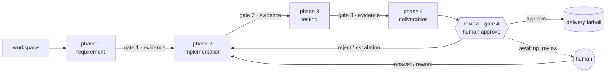
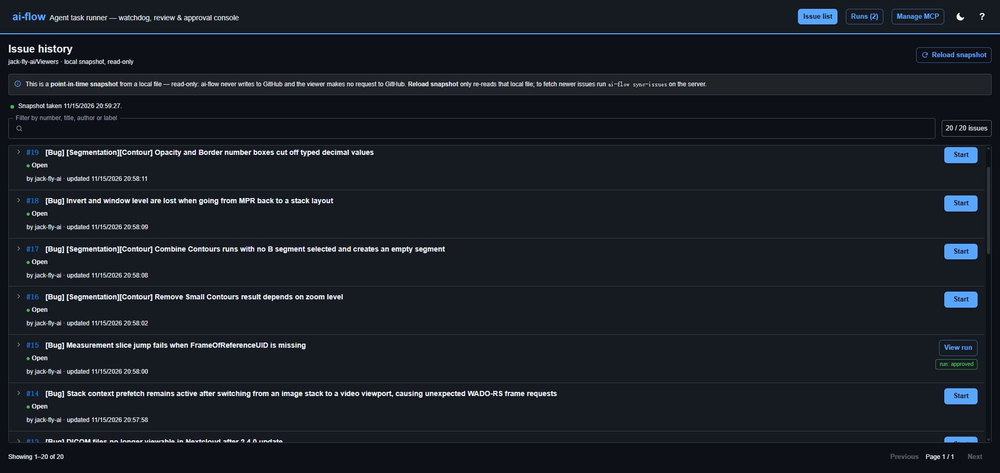
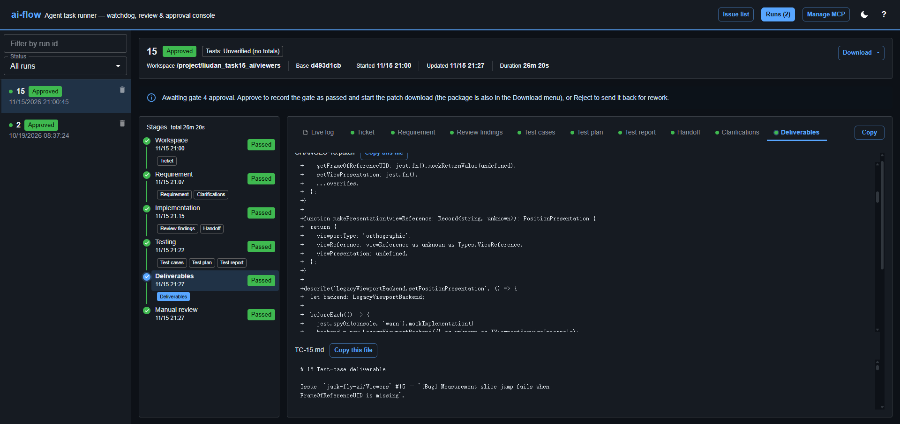
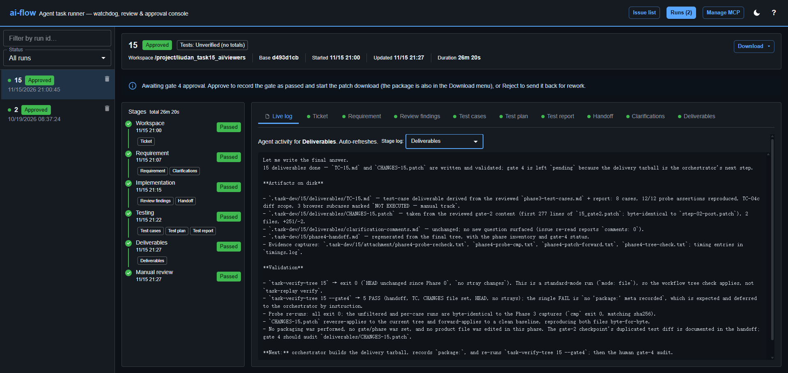

# ai-flow

A local, headless orchestrator for a single `TASK` ticket. It drives the [`task-dev`](../skills/task-dev) workflow through a fixed phase/gate state machine with a configured coding agent, verifies every gate's evidence, packages the delivery, and stops at one human checkpoint (gate 4).

## Two layers, two homes

| Layer | Location | Owns |
|---|---|---|
| **Runtime** (this repo) | `ai-flow/` | State machine, guardrails, CLI, viewer, packaging |
| **Skill** (policy / execution spec) | `../skills/task-dev/` | Phase 1–4 workflow files and `task-*` tools |

The runtime depends on the skill **by path** (`taskdev.skillDir`); the skill never depends on the runtime. Skill content is never copied into this repo, never committed here, and never shipped in a delivery tarball. A change that needs both layers must be made and tested in both.

## Requirements

- Node.js **>= 20**
- [pnpm](https://pnpm.io/)
- A headless coding CLI available on `PATH` (Cursor `agent`, Claude Code `claude`, ChatGPT `codex`, or DeepSeek `dsh`) — configured via `ai-flow init`
- The external `task-dev` skill tree (place it at `skills/task-dev`, or point `taskdev.skillDir` at it)

## Quick start

From the repository root:

```bash
pnpm install
pnpm run build

# Choose an agent and model; writes ai-flow.config.json
node ai-flow/dist/cli.js init

# Start (or resume) a run for a synced issue
node ai-flow/dist/cli.js run 12345

# Inspect runs, then open the status page
node ai-flow/dist/cli.js status
node ai-flow/dist/cli.js ui
```

To develop without a build: `npm run ai-flow -- <command>` from `ai-flow/` runs the TypeScript sources directly.

`ai-flow.config.json` is resolved from the repository root (or `ai-flow/`); see [`config.example.json`](config.example.json) for every supported option and its default. The real config file is gitignored — **never commit cookies or secret tokens**.

## CLI reference

```text
ai-flow init  [--agent cursor|claude|chatgpt|deepseek] [--model id] [--yes]
ai-flow run  <id> [--model provider/model] [--force]
ai-flow stop <id>
ai-flow reset <id> [--remove-workspace]
ai-flow status [<id>]
ai-flow sync-issues
ai-flow ui
```

- `init` — interactive agent/model selection, or non-interactive via flags. A re-init preserves a custom `runner.command`.
- `run` — starts a run, or resumes from the failed/rework stage. `--force` overrides a live run lock (only after stopping the other run).
- `stop` — stops a running run; state is preserved, so `run` resumes from there.
- `reset` — deletes the run record, task-dev state, and replay tree for a fresh start.
- `status` — lists runs (or prints one) as `id / stage / status`, plus owner and open escalation when present.
- `sync-issues` — offline snapshot of issues from `taskdev.repo` into a local file served read-only by the viewer. Requires `AI_FLOW_ISSUES_TOKEN` (GitHub fine-grained read-only, Issues: read); operator-only when auth is enabled.
- `ui` — starts the status page at `ui.host` / `ui.port`.

Exit codes: `1` = never started (missing config/command); `2` = a stage ran and failed.

With `auth.tokens` configured, export `AI_FLOW_TOKEN` for `run`/`status`/`stop`/`reset`.

## Workflow and gates

Stage order lives in `src/orchestrator.ts`. `task-progress` (in the skill) is the single source of truth for phase/gate state; `state.json` only mirrors it for the viewer.



Gates 1–3 pass automatically as soon as their evidence files exist; only gate 4 needs a human. On failure, `runPipeline` stops and the remaining stages are skipped.

| Stage | Who | Writes |
|---|---|---|
| `workspace` | Orchestrator: `task-workspace ensure` (replay: `task-replay init` at pre-fix baseline) | `state.taskdev` mode/workspace |
| `phase1` | Configured agent per `workflows/phase1-requirement.md` | requirement doc, ticket caches, clarifications |
| `phase2` | Configured agent per `workflows/phase2-implementation.md` | plan, code, review, gate-2 patch, handoff |
| `phase3` | Configured agent per `workflows/phase3-testing.md` | test plan, test report |
| `phase4` | Configured agent per `workflows/phase4-deliverables.md`, then orchestrator packages | deliverables, patch, tarball in `~/task` |
| `review` | Stops at gate 4, the only human checkpoint | `state.json` `awaiting_review` |

Gates 1–3 pass automatically once their evidence files exist. Gate 4 passes only through the viewer's **Approve**. An open escalation (`awaiting: E1–E7`) pauses as `awaiting_review` (`clarification`/`escalation`); the human's answer is recorded as `state.rework` and injected on resume. `runPipeline` stops on the first failure, later stages become `skipped`, and no package is written after a failed stage.

**Replay mode** (fix already in git) runs in a separate replay tree at `fix-commit^`, enforces a clean baseline, and audits per-phase overreach via `assertReplayNoOverreach`.

## Status page

The viewer is the only network surface, bound to `127.0.0.1:7777` by default. It lists `.ai-flow/runs/` and can start a local run from the synced issue list, retry a failed run, approve/reject a run awaiting review, escalate, download the delivery tarball, and open **Manage MCP** (operator-only) to edit the configured agent's MCP servers. There is no generic "create task" form — runs always start from a synced issue. The viewer never git-commits and never writes back to the ticket system.

If `ui.host` is exposed beyond loopback, also set `ui.token` (or `auth.tokens`); otherwise anyone reachable can start/stop runs, approve gate 4, and edit MCP config.

<details open>
<summary>Status page screenshots</summary>

The viewer in three states: the default issue + run lists, a run paused at
gate 4 for approval, and the live stage log of a running task. All captures are
sanitized (no tokens, cookies, tenant ids, or real issue content).

<p align="center">
  
  <br><em>Issue list and run queue — the default view and the only place to start a run.</em>
</p>

<p align="center">
  
  <br><em>Gate 4 review — the single human checkpoint, with Approve / Reject.</em>
</p>

<p align="center">
  
  <br><em>Live log of a running task, streamed from the agent via SSE.</em>
</p>

</details>

### Isolation edition

Adding an `auth.tokens` block enables per-tenant access on a shared machine: constant-time tokens, owner-scoped runs (cross-tenant runs return 404, not 403), and per-tenant workspace/delivery roots. A user sees and acts only on its own runs; the `operator` tenant sees every run and alone may Manage MCP. Omit the block for the default single local-operator tenant.

## Development

```bash
pnpm install
pnpm test && pnpm run build   # typecheck + node:test, then viewer build
pnpm test:ui                  # viewer React layer (vitest + jsdom)
pnpm run lint                 # eslint
pnpm run selfcheck            # harness-contract assertions
pnpm run metrics              # eval metrics

# Skill layer (separate repository)
bash ../skills/task-dev/tools/selftest
python3 ../skills/task-dev/tools/task-doctor
```

The runtime tests fake every task-dev operation against a synthetic skill root, so `pnpm test` passes without the internal skill present. `pnpm test:ui` covers the React layer the runtime suite cannot reach.

## Project layout

- `src/cli.ts` — `init` / `run` / `status` / `ui` / `stop` / `reset` / `sync-issues`
- `src/core/` — config loading, shared types, errors
- `src/state/` — `state.json` mirror + `rev`, lock, reset, stop
- `src/auth/` — tenancy, constant-time tokens, secret redaction
- `src/git/` — diff/patch, product-surface filtering, git ref-lock
- `src/agents/` — headless presets, process runner, MCP CRUD, init
- `src/orchestrator.ts`, `src/orchestrator/` — stage order, phase/gate state machine, replay guard, prompts, trace
- `src/taskdev/` — typed wrappers over the `task-*` tools
- `src/delivery/` — packaging and offline issue snapshot
- `src/adapters/` — `ModuleAdapter` contract, viewers adapter, generic adapter
- `src/viewer/` — HTTP API + static host, route handlers, guards
- `viewer-ui/` — React/MUI status page (`vite build` → `dist/viewer-ui/`)
- `test/` — `pnpm test`
- `tools/` — `self-check.ts`, `eval-metrics.ts`

Package manager: **pnpm**. Do not add a `packageManager` field or switch managers. No file in `src/`, `test/`, or `viewer-ui/src/` may exceed 1500 lines.

## Hard rules

1. Never `git commit` / `amend` / `push` from the pipeline — a human submits after gate 4.
2. github-mcp access is read-only — never comment on or change the ticket.
3. Never put MCP credentials or login cookies in the repo, `state.json`, or error text.
4. The status page may run/retry/escalate/approve(4)/reject/download and edit MCP (operator-only), but must never git-commit or write the ticket.
5. Only `task-progress` writes phase/gate state: orchestrator sets gates 1–3, viewer sets gate 4.
6. Module edits must obey the adapter's scope guards.
7. Changes to stage/gate behavior require an update to the matching suite under `test/`.

## Documentation

- [Run reference](docs/run-reference.md) — commands, config, agent presets, tokens
- [Module adapters](docs/module-adapters.md) — scope guards and drift protection
- [Isolation edition](docs/isolation.md) — tenancy, locks, liveness
- [Viewer invariants](docs/viewer-invariants.md) — conflict handling, tenancy by 404, SSE fallback
- [Harness engineering posture](docs/harness-posture.md) — practices and self-check contract
- [AGENTS.md](AGENTS.md) — contributor guide for changing `ai-flow/` itself

## License

**Proprietary and confidential. All rights reserved.** See [LICENSE](LICENSE). No use, copying, modification, or distribution is permitted without prior written permission from the copyright holder.
